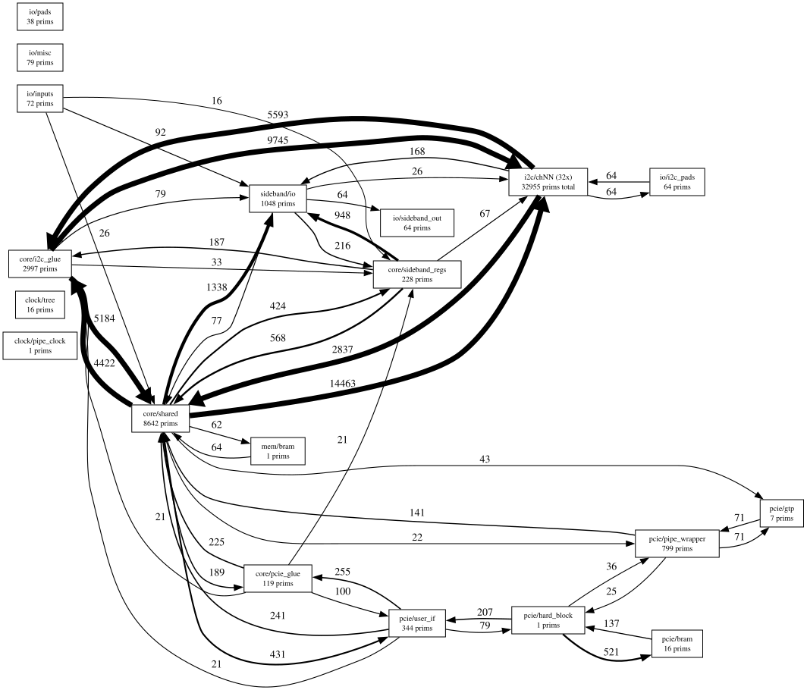

# i2cfpga layer 5: functional blocks of the flash update image

Date: 2026-11-10. Offline only. Built on the lossless layer-4 netlist
(`LAYER4.md`). The block assignment is an annotation over that netlist
(`work/rt4-*/l5/<image>.blocks.json`: every physical cell, physical net and
logical primitive gets a block path), and `roundtrip4.sh` splits the
netlist into one file per block, merges it back and rebuilds the flash
image byte for byte (see `LAYER4.md`, "Verification runs").

Marking, as in the reviews: **V** = verified by an exact structural check
on the netlist; **I** = inference. "Channel" numbers (`ch00..ch31`) are
the order of the pad pairs in `mtd5/update.io.txt`, **not** the driver's
port numbers: the mapping to BAR0 channel index was not established.

Reference outputs (small, tracked) in `mtd5/`:

- `update.blocks.md`: the generated block table with evidence
- `update.blocks.svg` / `.dot`: block-level graph
- `update.channels.txt`: per-channel numbers
- `update.pcie.txt`: PCIE_2_1 port groups, ties, MMCM features
- `update.io.txt`: IO classes, per bank, pad pairs
- `golden-vs-update.blocks.txt`, `update-vs-vendor-image1.blocks.txt`:
  block-level comparisons; `golden.blocks.md`, `vendor-image1.blocks.md`
- `update.blocks.json.gz`: the annotation itself (cells, nets, primitives)
- `roundtrip4-mtd5.txt`, `roundtrip4-vendor.txt`: the verification logs

Tool: `blocks.py analyse NET LOGIC OUTDIR --name N` (about 40 s).

## The design in one paragraph

A Xilinx 7-series PCIe endpoint (integrated block, gen2 x1, 64-bit TRN
user interface, user clock 62.5 MHz) whose user logic is almost entirely
32 copies of one I2C channel engine, each with its own open-drain SDA/SCL
pad pair and its own RAMB18 (512 x 36 simple dual port). A shared core
(about 4.4k FFs) sits between the PCIe interface and the channels, and a
sideband block drives 64 LUT-driven outputs and reads 72 inputs. All user
logic runs on one clock; the only other clocks are the PCIe PIPE, DRP and
reference clocks.

## Category table

Logical primitives per block (flash update image). Full generated table,
with nets, tile bounding boxes and links: `mtd5/update.blocks.md`.

| block | content | LUT | FF | other | conf. |
|---|---|---|---|---|---|
| `pcie/hard_block` | PCIE_2_1 (PCIE_X0Y0) | | | PCIE_2_1 1 | V |
| `pcie/gtp` | GTPE2_CHANNEL X0Y4 (lane 0), GTPE2_COMMON X0Y1, IBUFDS_GTE2 X0Y2, 4 IPADs | | | 7 | V |
| `pcie/bram` | RAMB18 on MIMTX* (8) and MIMRX* (8) | | | RAMB18E1 16 | V |
| `pcie/pipe_wrapper` | logic on pipe_clk / dclk_125 / refclk | 310 | 478 | SRLC32E 7, SRL16E 4 | V by clock, I as IP |
| `pcie/user_if` | first stage next to TRN RX / TX / CFG ports | 117 | 226 | CARRY4 1 | V adjacency, I role |
| `clock/pipe_clock` | MMCME2_ADV X0Y1 | | | 1 | V |
| `clock/tree` | 5 BUFGCTRL, 11 BUFHCE | | | 16 | V |
| `i2c/ch00..31` | 32 channel engines (28,720 analysis nodes matched in lockstep + 7,064 absorbed) | 17,892 | 14,802 | CARRY4 228, RAMB18E1 31 | V matched part, I absorbed part |
| `sideband/io` | logic around the 136 sideband pads | 511 | 537 | | V replicated, I role |
| `core/shared` | TLP decode, register file, read mux, completion path (not split further) | 4,210 | 4,407 | CARRY4 9, MUXF7 16 | I |
| `core/i2c_glue` | shared logic mostly connected to channels | 1,991 | 974 | CARRY4 32 | I |
| `core/pcie_glue`, `core/sideband_regs` | shared logic mostly connected to user_if / sideband | 206 | 141 | | I |
| `mem/bram` | the one channel BRAM whose channel was not matched | | | RAMB18E1 1 | I |
| `io/*` | 64 open-drain IOBUF, 64 LUT-driven OBUF, 72 IBUF, 38 other pads, IOI ties | | | | V |

## Clocking (V, with frequencies I)

From the BUFG/BUFH/MMCM wiring and the MMCM counters (`mtd5/update.pcie.txt`):

    MGTREFCLK0_216 -> IBUFDS_GTE2_X0Y2 -> GTPE2_COMMON GTREFCLK0  (and BUFG X0Y16 -> BUFH, 9 FFs)
    GTP TXOUTCLK -> BUFG X0Y17 -> BUFH X0Y12 -> MMCM CLKIN1
    MMCM CLKFBOUT -> CLKFBIN (direct)        M = 10, D = 1
    CLKOUT0 /8  -> BUFG X0Y2  (dclk_125: 143 FFs)  and BUFGCTRL X0Y1.I0
    CLKOUT1 /4  -> BUFGCTRL X0Y1.I1   (BUFGCTRL X0Y1 = pipe_clk mux, S0/S1 from fabric: 337 FFs,
                                       PCIE PIPECLK, GTP TX/RXUSRCLK)
    CLKOUT2 /16 -> BUFG X0Y0 -> 6 BUFH -> user_clk: PCIE USERCLK + 21,113 FFs/BRAMs (everything else)
    CLKOUT3 /16, CLKOUT4 /20 configured, outputs not enabled

With a 100 MHz reference (I) this is 1 GHz VCO, 125/250 MHz PIPE clock,
62.5 MHz user clock. **Match: Xilinx 7-series PCIe `pipe_clock`** (V for
the topology: BUFG on TXOUTCLK into the MMCM, direct feedback, a BUFGCTRL
mux of /8 and /4 for the gen1/gen2 PIPE clock, a BUFG on /8 for DCLK, the
user clock on /16 = `USER_CLK_FREQ=1`; I for the identification, since a
hand-made equivalent would look the same).

## PCIe neighbourhood

- **Hard block configuration** (V, from FASM attributes, layer 3): gen2
  x1, three 1 MiB memory BARs, class 0x058000, MSI (64-bit) + MSI-X, AER,
  DSN, VSEC 0x1234.
- **IDs are fabric ties** (V): `CFGVENDID = 0x1d0f`, `CFGDEVID = 0x8571`,
  `CFGREVID = 0x01`, `CFGSUBSYSVENDID = CFGSUBSYSID = 0x0000`, all from
  TIEOFF/constant nets. `CFGDSN` is tied to 0 (DSN capability present but
  serial number 0).
- **User interface**: TRN, 64 bits used (`TRNTD[127:64]` tied to 0;
  `TRNTD[63:0]` from 64 FDRE), RX data, SOF/EOF, BAR hit, src_rdy/dsc into
  the first register stage (V). `CFGINTERRUPT*` driven (MSI/INTx for the
  presence IRQ), `CFGMGMT*` unused (no configuration-space access from the
  fabric), DRP port unused, `PLDIRECTED*` tied (V). The TX side's 68-FF
  register stage (64 data + EOF/REM/SRC_RDY...) is what
  `pcie_7x_axi_basic_tx_pipeline` would produce (I); this was not checked
  further.
- **MIM BRAMs** (V): 8 RAMB18 on `MIMTX*`, 8 on `MIMRX*`; 11 address bits
  per BRAM, 69/68 data bits, all in TDP mode, width 9, `DOB_REG`. This is
  the 7-series PCIe block's TX retry buffer and RX receive buffer
  (`pcie_bram_7x`, 8 x 2k x 9 each) (I for the IP name; V for the
  attachment).
- **PIPE wrapper** (V by clock domain): 478 FFs and 310 LUTs on the PIPE,
  DRP and refclk clocks, plus 11 SRLs; it is the only logic connected to
  the GTP's PIPE-side ports and to `PIPERX0*`/`PIPETX0*` of PCIE_2_1 (V).
  Name: `pcie_7x` `pipe_wrapper` (reset, rate, sync, DRP FSMs) (I).
- **User side**: not the Xilinx PIO example design (I): there is no EP_MEM
  set of 4 BRAMs on the TRN path; instead 32 channel BRAMs and a large
  shared register core. No AXI interconnect structure was recognised.

## IO ring (V for classes, I for functions)

From `mtd5/update.io.txt` (package pins assume FGG484):

| class | count | banks | function (I) |
|---|---|---|---|
| IOBUF, I = GND, T = FDPE (INIT 1), LVCMOS33 I12_I8 | 64 | 13:7, 15:17, 16:21, 34:17, 35:2 | 32 x (SDA, SCL), open drain, released at reset |
| OBUF driven by LUT6_2, I12_I16 | 64 | 13:6, 15:2, 16:27, 34:18, 35:11 | 32 x LPMode + 32 x ResetL |
| IBUF with a load | 72 | 13:12, 14:3, 15:9, 16:2, 34:13, 35:33 | 32 x ModPrsL + 32 x IntL + 8 others |
| configured, no load (`IOB_CFG_ONLY`) | 34 | | unused / reserved pins |
| IOBUF I = LUT, T = FDSE | 1 | 15 (J16) | possibly the 0x6a I2C slave or a board control line |
| OBUF from FF / VCC | 3 | 14, 15 | |

The 64 sideband outputs are not plain register bits: each output LUT
mixes 2-3 register FFs, one input pad and two global select signals
(`SLICE_X76Y107/BMUX`, `SLICE_X77Y107/C`) (V for the structure), so the
outputs have at least two modes (I). The registers behind them are
byte-enabled: 8 CE nets with 8 FFs each, i.e. two 32-bit registers written
by byte lanes (V), matching `0x170` (LPMode) and `0x178` (reset) (I).

## The 32 I2C channel engines

- **Pairing** (V): each of the 64 open-drain pads has exactly one partner
  whose local logic overlaps (Jaccard 0.17-0.18 over 8-hop
  neighbourhoods, nets with at most 12 sinks, LUT6_2 halves split); its
  second-best overlap is 0.00. The pairs are mutual.
- **Pad drivers** (V): in every channel one pad's T-FF D input is the OR of
  3 signals and the other's a 4-input function; both FFs are FDPE INIT 1.
- **Replication** (V): lockstep growth from the 32 pad pairs (a node joins
  only if the same label and the same connections to already matched
  roles occur in at least 16 channels) matched 28,720 analysis nodes in
  847 roles; 575 roles occur in exactly 16 channels, 99 in all 32. The
  channels fall into **two structural families of 16** (role-set overlap
  >= 0.7 within a family; the update image's matching splits one channel,
  `ch01`, off family A, the golden image gives two clean families of 16).
  Family A (`ch00,01,02,04,05,06,09,10,14,17,19,22,25,26,30,31`):
  310-436 FFs / 360-513 LUTs and 5-7 CARRY4 per channel. Family B (the other 16): 526-578
  FFs / 620-676 LUTs and 8 CARRY4. B has extra 16-FF registers (8 groups of 16
  with their own CE in `ch03`, against 4 in `ch00`) and per-channel control
  nets with a few more sinks (for example 339 vs 333-334). What the extra
  logic does is open.
- **One BRAM per channel** (V): 31 of 32 channels attach to exactly one
  RAMB18 in SDP 36-bit mode (the 32nd channel's BRAM is the one left in
  `mem/bram`; its attachment was not matched). The channel drives 8 of the
  9 read and write address bits, the enables and `WEBWE`; data in comes
  through per-bit LUT muxes. 256 x 32 bits = 1 KiB per channel, which fits
  a 512-byte write window plus a 512-byte read window (`0x4000 + ch*0x200`,
  `0x8000 + ch*0x200`) (I).
- **Per-channel registers** (V for the groups, I for the names): FFs grouped
  by CE net show a 32-FF group (fits the clock-profile register
  `cb+0x00`), 16- and 8-FF groups (command/length/address fields) and the
  FSM/counter FFs on CE = VCC. Almost all channel FFs are FDCE (async
  clear), as is the whole user design.
- **Clock divider codes** 0x18 / 0x09 / 0x66: not located. No comparator
  constant was extracted (see "Register map").

## Shared core and the register map

- `core/shared` (I): 4.4k FFs / 4.2k LUTs that touch many channels:
  the TLP decode, the global registers (`0x000` version, `0x004` scratch,
  `0x140..0x178`), the BAR0 read mux and the completion path. Not split
  further.
- **Address constants: not established.** Attempt: BDDs of write-enable
  cones (LUT trees down to FFs). The sideband register byte enables depend
  on 61 FFs (42 cubes, only 2 forced literals); a channel's 32-FF register
  enable on 49 FFs (166 cubes, 5 forced). The enables are OR terms of
  decoder state, write strobes and other state, not a single
  `addr == const` comparison, so no constant such as 0x140 or 0x1000 could
  be read off. Next step: identify the TLP address register FFs (from
  `TRNRD[63:32]` of the second beat) and evaluate the cones with all other
  leaves fixed to their "write in progress" values.

## Golden vs update

See `mtd5/golden-vs-update.blocks.txt` (and `mtd5/golden.blocks.md`).

- The two flash images have **the same 32 pad pairs** and the **same 16 pad
  pairs in the larger channel family** (V: independent runs of the pairing
  and the lockstep matching on each image). So the two families are a
  property of the design, not of one place-and-route run.
- Hard blocks, pads, PCIe BRAMs and the pipe clock are unchanged (label
  multisets identical, V). The IO configuration was already identical at
  layer 3.
- Logic changed mostly inside the channels and the shared core: label
  multiset differences (functions up to input order) `i2c/chNN` +56/-419,
  `core/shared` +323/-145, `core/i2c_glue` +185/-155, `sideband/io` +44/-4,
  `pipe_wrapper` +12/-0. Channel totals: golden 18,076 LUT / 14,853 FF,
  update 17,892 / 14,802. Part of this is Vivado mapping noise (the same
  logic packed into different LUT functions); separating real changes from
  that noise needs a functional (cone) comparison, not done.
- BUFHCE 12 -> 11 (one fewer clock region buffer), as layer 3 saw.

## Known IP, summary

| IP | evidence | conf. |
|---|---|---|
| Xilinx 7-series Integrated Block for PCIe (PCIE_2_1 + pcie_7x wrapper) | hard block, 64-bit TRN, MIM BRAM buffers, PIPE lane 0 to GTP lane 0 | V (hard block, wiring) |
| pcie_7x `pipe_clock` (gen2, 1 lane, 62.5 MHz user clock) | MMCM M=10 D=1, /8 /4 /16 (+ /16 /20 unused), BUFGCTRL pclk mux, direct feedback | V topology / I name |
| pcie_7x `pipe_wrapper` + GTPE2 PIPE | logic on pipe_clk/dclk/refclk only, sole user of GTP PIPE ports | V by clock / I name |
| `pcie_bram_7x` TX retry / RX buffers | 2 x 8 RAMB18 2k x 9 on MIM ports | V attachment / I name |
| AXI-basic TRN shim | 64+4 FF TX register stage, RX first stage | I |
| PIO example design | not matched (no EP_MEM, different BRAM use) | I |
| I2C engine | custom; no OpenCores i2c_master or AXI IIC structure recognised | I |
| Xilinx FIFO generator | none: all user BRAMs are plain RAMB18 SDP, no FIFO mode | V (features) |

## Open questions / next steps

1. Map `ch00..31` to driver ports: needs the TLP address register and the
   channel decode (see above), or a hardware test (toggle LPMode for one
   port and see which pad moves, once offline work allows).
2. What distinguishes the two channel families?
3. Which input pads are ModPrsL and which IntL; what the 8 extra inputs and
   the J16 IOBUF are.
4. Per-channel function split (FSM, bit counter, SCL divider, data path):
   compare roles across channels against a small reference I2C engine.
5. Vendor v01.02.0E image1 (done as a first look, `mtd5/vendor-image1.blocks.md`,
   `mtd5/update-vs-vendor-image1.blocks.txt`): same 32 pad pairs (V); 16
   channels again form the larger family, 13 of them the same pad pairs as
   in the flash build; `core/shared` is about twice as large (9.2k LUT /
   8.5k FF) and the channel matching is weaker (several channels match only
   about 250 nodes). Not analysed further.
