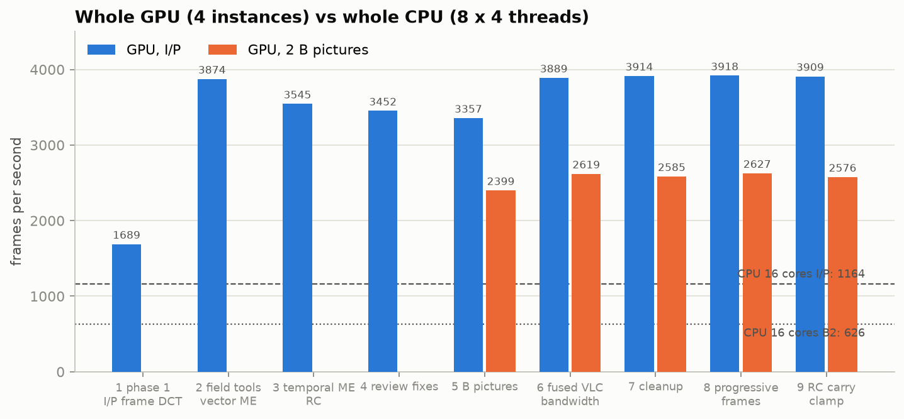
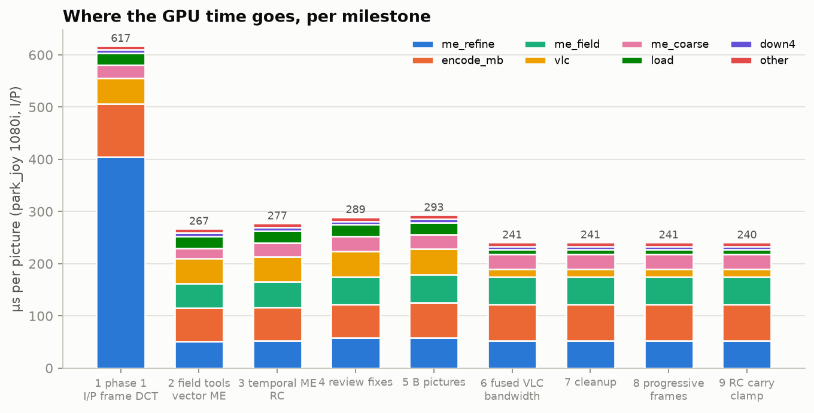
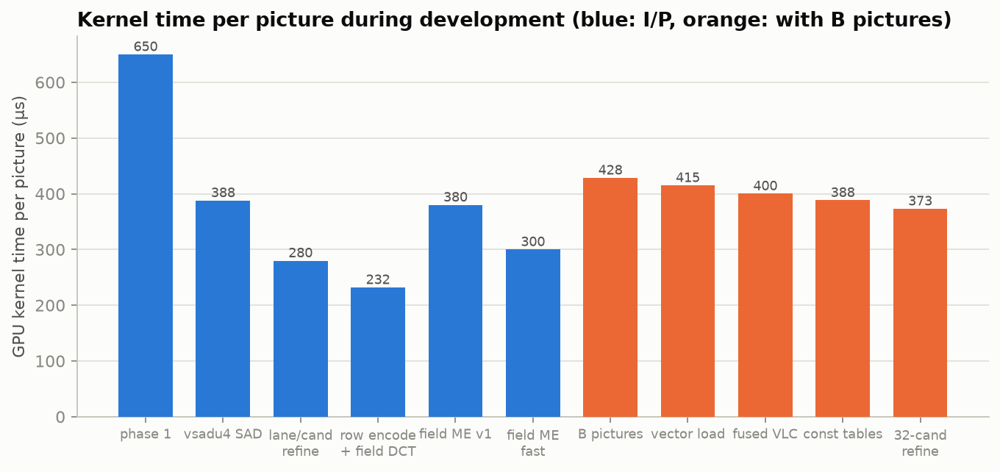
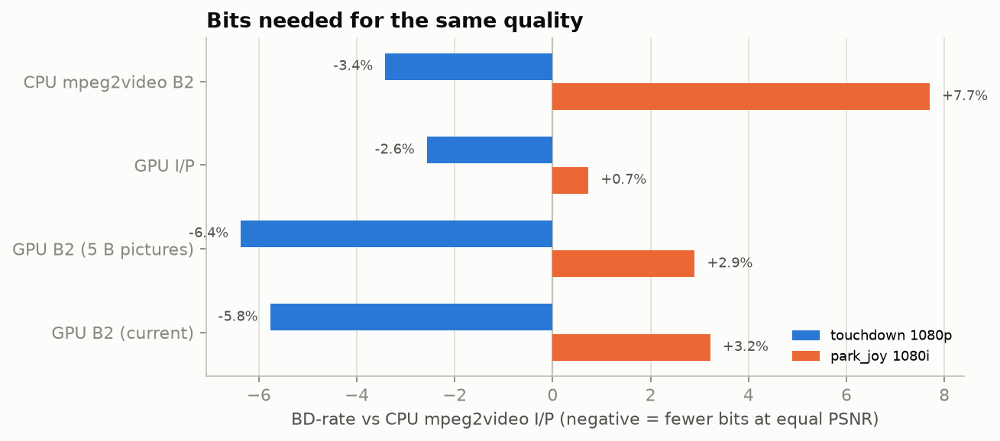

# mpeg2_cuda: the journey, with data

An MPEG-2 video encoder inside FFmpeg (`-c:v mpeg2_cuda`) that runs on an
RTX 3090, built between 2026-10-15 and 2026-10-16 to feed 1080i MPEG-2
transport streams to a Blonder Tongue EQAM-420B (clear QAM to TVs at home).
Everything from motion estimation to slice packing runs on the GPU; the host
writes headers and runs rate control.

Machine: Ryzen 9 7950X (16C/32T), RTX 3090 (driver 595.104, CUDA 13.2 pinned
in `flake.nix`), NixOS. FFmpeg n9.0.2 + the `mpeg2_cuda` branch
(`patches/`). Charts: `docs/img/`, raw data: `docs/data/`, scripts that
produced them: `docs/hist_build.sh`, `docs/measure_fps.sh`,
`docs/make_charts.py`, `docs/journey_tables.py`.

## How the numbers were taken

- **Encoder-only fps**: `tools/m2c_bench.c` preloads 60 decoded frames
  (into GPU memory for mpeg2_cuda) and encodes N frames per instance by
  cycling them, 15 Mbps. For the milestone table every commit was rebuilt in
  its own git worktree (`docs/hist_build.sh`, minimal FFmpeg config) and
  measured back to back on an idle GPU (`docs/measure_fps.sh`, 2026-10-16
  01:27-01:38; the six live test channels were paused for it). N=6000 per
  instance; one instance reports its own rate; four instances report total
  frames over wall time; best of two runs. The bench copy used for this adds
  `av_frame_copy_props()` after the GPU upload: without it the interlace flag
  of park_joy is lost and the last milestones (which code progressive frames
  differently) would look faster on interlaced content than they are.
- **CPU baseline**: the same harness with `mpeg2video`, matched options
  (`+ilme+ildct`, alternate scan, intra VLC format, GOP 15), CBR =
  `minrate=maxrate=15M, bufsize=7.5M`, ABR = `b=15M` only. One process with
  automatic threads, and 8 processes x 4 threads for the whole machine.
- **Quality**: PSNR/SSIM via `scripts/psnr.sh` (decodes to y4m, trims both
  inputs, `shortest=1`), BD-rate via `scripts/rd.sh` + `tools/bdrate.py`
  (piecewise-linear; touchdown q 2-13, park_joy q 10-31).
- Test clips: `touchdown_1080p` (Xiph, progressive 29.97) and `park_joy_1080i`
  (Xiph park_joy 1080p50 interlaced into real TFF 1080i, relabelled 29.97).

## Baselines

### The first question: how many 1080i MPEG-2 streams can this box make?
Before any GPU encoder existed (two Sonnet benchmark agents, H.264 1080p
source -> MPEG-2 1080i 15M CBR + AC-3 in MPEG-TS, live `-re` runs):

| pipeline | 1 stream | streams at realtime | bottleneck |
|---|---|---|---|
| NVDEC decode + CPU mpeg2video (fast) | ~495-527 fps | 25 | NVDEC (CPU ~42%) |
| NVDEC decode + CPU mpeg2video (quality: `-mbd rd -trellis 1`) | ~104-111 fps | 6 | CPU (~99%) |
| CPU decode + CPU mpeg2video (fast) | ~345 fps | 26 (25 with margin) | CPU (~99%) |
| CPU decode + CPU mpeg2video (quality) | ~93 fps | 7 | CPU |

NVENC has no MPEG-2 encoder at all, which is why this project exists.

### CPU mpeg2video, encoder only (re-measured 2026-10-16)
<!--BEGIN CPU-->
| clip | rate control | B pictures | 1 stream (threads=auto) | 8 processes x 4 threads |
|---|---|---|---|---|
| parkjoy_1080i | CBR | 0 | 464 | 1164 |
| parkjoy_1080i | CBR | 2 | 284 | 626 |
| parkjoy_1080i | ABR | 0 | 481 | 1176 |
| parkjoy_1080i | ABR | 2 | 289 | 664 |
| touchdown_1080p | CBR | 0 | 517 | 1273 |
| touchdown_1080p | CBR | 2 | 304 | 722 |
| touchdown_1080p | ABR | 0 | 537 | 1341 |
| touchdown_1080p | ABR | 2 | 324 | 770 |
<!--END CPU-->

Two measurement mistakes were made on the way and are corrected here:
the first harness run fed `mpeg2video` frames still tagged `pict_type=I`
(rawvideo decoder), so every picture was coded intra and it looked like
~1440 fps single / ~3300 fps aggregate; and an early CBR-only reading
(~285 / ~650) was the same all-intra artefact. The numbers above supersede
both.

## Milestones (encoder-only fps, 15 Mbps, idle GPU)

<!--BEGIN FPS-->
| milestone | commit | park_joy 1080i I/P: 1 / 4 inst | park_joy B2: 1 / 4 | touchdown I/P: 1 / 4 | touchdown B2: 1 / 4 | kernel µs/pic (pj, I/P) |
|---|---|---|---|---|---|---|
| 1. Phase 1: I/P, frame DCT | `dea7407` | 1492 / 1689 | – / – | 1497 / 1676 | – / – | 617 |
| 2. Field DCT + field ME, vectorised ME, row transform, VBV RC | `f554c30` | 3140 / 3874 | – / – | 3268 / 3969 | – / – | 267 |
| 3. Temporal ME, adaptive f_code, damped RC | `525ec8a` | 2975 / 3545 | – / – | 3025 / 3603 | – / – | 277 |
| 4. Codex review fixes (OOB reads, MV cost wrap) | `9819724` | 2869 / 3452 | – / – | 2907 / 3500 | – / – | 289 |
| 5. B pictures | `39fe7db` | 2827 / 3357 | 1989 / 2399 | 2857 / 3408 | 1989 / 2470 | 293 |
| 6. Fused VLC, bandwidth, constant tables, 32-cand refine | `6fe6f2c` | 3314 / 3889 | 2222 / 2619 | 3367 / 3989 | 2260 / 2721 | 241 |
| 7. Drop field_skip | `36c2f15` | 3332 / 3914 | 2226 / 2585 | 3350 / 3964 | 2255 / 2672 | 241 |
| 8. Source field order, progressive_frame, first-I calibration | `0aa2090` | 3331 / 3918 | 2188 / 2627 | 4157 / 5116 | 2951 / 3520 | 241 |
| 9. CBR carry-over clamp, proportional VBV re-code | `e14023c` | 3323 / 3909 | 2218 / 2576 | 4108 / 5068 | 2957 / 3692 | 240 |
<!--END FPS-->

Milestone 8 is the big jump on touchdown only: progressive sources are now
coded as `progressive_frame` pictures, which skips field motion search and the
field DCT decision. Interlaced park_joy is unchanged by it, as it should be.

### What each milestone changed and what it cost or bought

1. **`dea7407` Phase 1** (I/P, frame DCT, half-pel ME, one slice per MB row,
   GPU VLC + slice packing, TM5-style RC). Bit-exact against FFmpeg's decoder
   on the first run. ~1500 fps for one stream; the profile showed the motion
   refinement at 470 of 650 µs per picture, all byte loads.
2. **`f554c30` Field tools and the first big speed-ups.** Recorded during
   development (uncommitted intermediate states, same harness but different
   N): packed-byte SAD (`__vsadu4`, funnel-shift loads) took refinement from
   470 to 170 µs (~2280 fps); one candidate per lane took it to 61 µs
   (~3100 fps); a thread-per-row `k_encode_mb` with warp transposes took
   that kernel from 117 to 67 µs (~3550 fps, the I/P peak before field
   motion). Field motion search then cost 153 µs in its first version
   (~2460 fps) and 59 µs after a one-round rewrite. Committed result: ~3140
   fps, with field DCT, field motion and VBV-safe rate control.
3. **`525ec8a` Temporal predictors, adaptive f_code, tuned dead zone, damped
   RC** - a quality milestone; ~5% slower (larger search window around the
   previous picture's vectors).
4. **`9819724` Codex review fixes** - out-of-bounds half-pel reads (found by
   compute-sanitizer), plane padding, the MV-cost modulo wrap; ~4% slower
   (bounded loads).
5. **`39fe7db` B pictures** - reorder buffer, open GOPs, forward/backward/bi
   with frame and field vectors. Each B picture runs two directional searches
   plus a bidirectional decision, so with two B pictures per anchor the
   default configuration drops to ~1990 fps for one stream.
6. **`6fe6f2c` Bandwidth work** - vectorised input load (23 -> 9 µs),
   coefficient VLC fused into the transform kernel (the 6.3 MB dense level
   array per picture disappears; `k_vlc` 48 -> 19 µs), uniform tables in
   `__constant__` (`k_encode_mb` 84 -> 73 µs), one-round 32-candidate
   refinement (62 -> 52 µs). +17% I/P, +12% with B pictures.
7. **`36c2f15`** removed an option that measured as a no-op.
8. **`0aa2090`** follows the source's field order; progressive frames coded
   as progressive pictures; non-linear quantiser below 2; first-I calibration.
9. **`e14023c`** clamps the CBR budget carry-over to the VBV and makes VBV
   re-coding proportional. Speed unchanged.

<!--BEGIN KERNELS-->
| kernel (µs per call, park_joy I/P) | `dea7407` | `f554c30` | `525ec8a` | `9819724` | `39fe7db` | `6fe6f2c` | `36c2f15` | `0aa2090` | `e14023c` |
|---|---|---|---|---|---|---|---|---|---|
| k_me_refine | 433 | 54 | 56 | 63 | 63 | 56 | 56 | 56 | 56 |
| k_encode_mb | 102 | 64 | 64 | 64 | 67 | 70 | 70 | 70 | 69 |
| k_me_field | – | 51 | 52 | 56 | 56 | 56 | 56 | 56 | 56 |
| k_vlc | 50 | 48 | 49 | 49 | 49 | 15 | 15 | 15 | 15 |
| k_me_coarse | 27 | 21 | 28 | 30 | 30 | 30 | 30 | 30 | 30 |
| k_load | 23 | 23 | 23 | 23 | 23 | 9 | 9 | 9 | 9 |
| k_pack | 4 | 4 | 5 | 5 | 4 | 5 | 5 | 5 | 5 |
| k_down4 | 4 | 4 | 4 | 4 | 4 | 3 | 3 | 3 | 3 |
| k_concat | 3 | 3 | 3 | 3 | 3 | 3 | 3 | 3 | 3 |
<!--END KERNELS-->

## Quality

BD-rate against CPU `mpeg2video` I/P (negative = fewer bits for the same
PSNR):

| encoder | touchdown | park_joy 1080i |
|---|---|---|
| CPU mpeg2video, 2 B pictures | -3.4% | +7.7% |
| GPU I/P | -2.6% | +0.7% |
| GPU, 2 B pictures (`39fe7db`) | -6.4% | +2.9% |
| GPU, 2 B pictures (current, 32-candidate refinement) | -5.8% | +3.2% |

So with B pictures the GPU encoder needs ~3% fewer bits than the CPU's own
B-picture mode on touchdown and ~4.5% fewer on park_joy. (RD curves:
`img/rd_td.png`, `img/rd_pj.png`; the GPU curves were measured at `39fe7db`.)

At 15 Mbps CBR, PSNR-Y / SSIM-Y (240 frames):

| | touchdown | park_joy 1080i |
|---|---|---|
| CPU mpeg2video I/P | 38.52 / 0.9276 | 25.14 / 0.7278 |
| GPU phase 1 | 38.23 / 0.9270 | 24.64 / 0.6960 |
| GPU + field DCT + field motion | 38.07 / 0.9261 | 24.98 / 0.7184 |
| GPU + damped rate control | 38.65 / 0.9274 | 25.38 / 0.7290 |
| GPU, 2 B pictures | 38.83 / 0.9300 | 25.32 / 0.7311 |

(Early rows were measured with ffmpeg's `psnr` filter directly, before the
frame-pairing bug below was found; I/P rows were usually unaffected.)

### A/B against mpeg2video (`tests/ab.sh`)
Matched settings, same source; checks stream properties, field order against
the source, timestamps, bitrate, VBV, PSNR/worst frame, mean Y/U/V levels and
temporal/field alignment. Quick set (6 cases): mpeg2_cuda ahead on PSNR in
every case (+0.13 to +2.70 dB). Full set (14 cases) passes after `e14023c`;
the run before it failed on park_joy at 8 Mbps (VBV, on the CPU side), two
small-resolution bitrate overshoots and a 904 channel case, which is what
`e14023c` addressed.

## Bugs found, and what found them

| bug | found by |
|---|---|
| nvcc 13.4 emits PTX the 595 driver rejects | first CUDA filter smoke test; CUDA pinned to 13.2 |
| ffnvcodec only exposes the legacy 32-bit `cuModuleGetGlobal` | first run; tables copied by a kernel instead |
| `put_motion` tested for zero before the modulo wrap | `scripts/stress.sh` (park_joy q8) + `tools/m2vparse.py` |
| FFmpeg skips the wrap for a zero MV delta (field PMV out of range) | same; field vertical vectors limited to keep PMV in range |
| interlaced `mb_height` must be 2*ceil(h/32) (720 lines -> 46 rows) | designing `tools/m2vcheck.py` |
| out-of-bounds half-pel reads in ME; `build.sh` masking make failures; MV cost without wrap | Codex review + compute-sanitizer |
| rate control oscillating q 3 <-> 28 | per-picture q trace |
| first GOP overspend, end-of-stream budget dump | RC accounting trace |
| field order ignored; progressive input coded as interlaced | `tests/ab.sh` field-order check |
| CPU harness all-intra (`pict_type=I` frames) | identical bf=0/bf=2 bitrates |
| `psnr` filter averaging extra misaligned pairs (B pictures) | nondeterministic PSNR from a deterministic stream |
| VBV checker assuming 29.97 for a 25 fps clip | false underflow in the test matrix |
| benchmarks taken while NVENC jobs / test runs used the GPU | re-measured idle (this document) |
| GPU upload in the bench dropping the interlace flag | this document's milestone pass |

Test suites today: `tests/run.sh full` (95 cases: strict decode + bit-exact
recon + independent syntax checker + VBV + libmpeg2 cross-decode + memcheck)
and `tests/ab.sh full` (14 cases).

## Live channels and the EQAM

Six looping test channels (900 TESTCAT ... 905 TSTFISH, H.264 1080p sources
upscaled from YouTube) run as NVDEC -> mpeg2_cuda (15M, 2 B pictures) +
AC-3 -> SPTS over UDP into the EQAM's GigE port. Stress test: 6 channels x 4
copies = 24 live 1080i streams at 1.01x realtime with ~1.3% whole-box CPU,
~33% GPU SMs and ~86% NVDEC. For H.264 sources the decoder, not the MPEG-2
encoder, is now the box's ceiling.

## Prior art

See `docs/prior_art.md`: GPU pieces of MPEG-2 encoders exist in the
literature (Montero et al., 2010-2013) and Elemental shipped closed GPU
appliances; no open, fully on-GPU, decoder-bit-exact, interlace-aware MPEG-2
encoder was found.
